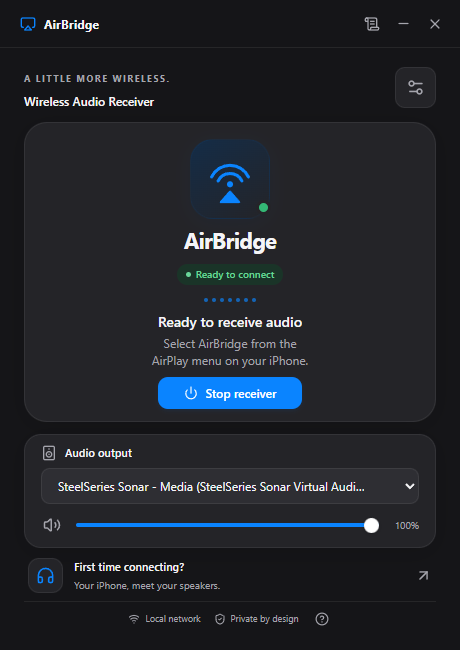
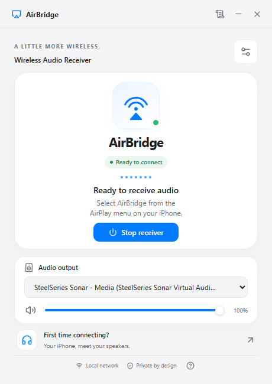
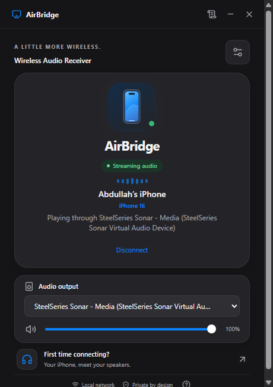
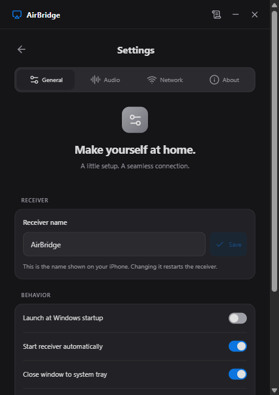

<p align="center"></p>
<h1 align="center">AirBridge</h1>
<p align="center"><strong>صوت آيفونك، على سماعات الكمبيوتر.</strong><br/>A local AirPlay audio receiver for Windows 11.</p>
<p align="center"><a href="https://github.com/Abwtt09/AirBridge/releases/latest">تحميل أحدث إصدار</a> · <a href="#طريقة-الاستخدام">طريقة الاستخدام</a> · <a href="#التحديثات">التحديثات</a> · <a href="#الخطة-المستقبلية">الخطة المستقبلية</a> · <a href="docs/BUILD.md">Build from source</a></p>

---

AirBridge يحوّل جهاز Windows إلى مستقبل صوت AirPlay حقيقي. اختره من قائمة الصوت في الآيفون، واستمع عبر السماعات أو سماعة الرأس المحددة في التطبيق، باستخدام الشبكة المحلية.

**Windows 11 x64 · Tauri 2 + Rust · React + TypeScript · WASAPI · GPL-3.0-or-later**

> الإصدار الأول **0.1.0** يركز على استقبال الصوت. اختُبر الاتصال والصوت المستقر والتعرف على الموديل باستخدام **iPhone 16 على iOS 27**. التوافق مع أجهزة وتطبيقات وشبكات أخرى قد يختلف. مشاركة الشاشة والملفات ليست متوفرة في هذا الإصدار.

## نظرة على التطبيق

<p align="center"> </p>

**واجهة المستقبل:** تعرض جاهزية الاتصال، حالة البث، جهاز إخراج الصوت، ومستوى صوت التطبيق. الصور مأخوذة من التطبيق الفعلي بالوضعين الفاتح والداكن.

<p align="center"> </p>

**أثناء البث:** يظهر اسم الجهاز والموديل عند إرساله عبر البروتوكول، مع رسم أصلي مناسب لعائلة الجهاز ومؤشر نشاط مبني على مستوى الصوت المقاس. الصورة توثّق جلسة اختبار حقيقية. **الإعدادات:** تجمع خيارات التشغيل والصوت والشبكة والمظهر والتحديثات في واجهة واحدة.

## مميزات الإصدار الأول

| الميزة | التفاصيل |
|---|---|
| استقبال AirPlay فعلي | مسار صوت أصلي: UxPlay → GStreamer → Windows WASAPI. |
| الظهور على الشبكة | إعلان mDNS/DNS-SD باسم قابل للتخصيص، مع دعم اتصالات IPv4 وIPv6 المحلية. |
| اختيار إخراج الصوت | اتبع مخرج Windows الافتراضي أو اختر سماعات USB أو Bluetooth أو HDMI المتاحة. تغيير المخرج يعيد تشغيل المستقبل. |
| التحكم بالصوت | مستوى صوت وكتم خاصان بالتطبيق، دون تغيير مستوى صوت Windows العام. |
| إعدادات التخزين المؤقت | Low Latency وBalanced وStable لإخراج WASAPI؛ لا تمثل ضمانًا لقيمة التأخير الكلية. |
| التعرف على الجهاز | أسماء موديلات iPhone معروفة، ورموز للهاتف والآيباد، باستخدام معرّف الجهاز المرسل. الأجهزة غير المعروفة تحصل على رمز عام. |
| مؤشر نشاط حقيقي | يعتمد على RMS المقاس؛ يتوقف مع تقليل الحركة أو إخفاء النافذة. |
| التشغيل في الخلفية | إغلاق النافذة إلى شريط النظام، مع قائمة لتشغيل المستقبل وإيقافه والخروج. |
| سجل تشخيص داخل التطبيق | آخر 300 حدث في الذاكرة: مراحل الاتصال، الاستجابات وحزم الصوت؛ لا يسجّل الصوت أو مفاتيح التشفير. |
| حفظ الإعدادات | الاسم، المخرج، الصوت، المظهر، بدء التشغيل وخيارات التحديث تُحفظ محليًا. |
| تحديثات موقّعة | فحص إصدارات GitHub وإشعار داخل التطبيق، مع تنزيل وتثبيت بعد اختيار المستخدم والتحقق من التوقيع. |

## التحميل والتثبيت

1. افتح [صفحة الإصدارات](https://github.com/Abwtt09/AirBridge/releases/latest).
2. حمّل **`AirBridge_0.1.0_x64-setup.exe`** وثبّته لحسابك في Windows.
3. أكمل الإعداد الأول واختر اسم المستقبل ومخرج الصوت.
4. اسمح للمستقبل `uxplay.exe` بالوصول إلى شبكتك الخاصة الموثوقة في Windows Firewall.

المتطلبات: **Windows 11 x64**، جهاز إخراج صوت متاح، وMicrosoft Edge WebView2. إذا كان WebView2 غير مثبت، قد يحتاج المثبّت إلى الإنترنت لتثبيته. الاستخدام العادي لا يتطلب صلاحيات مسؤول.

مثبّت الإصدار الأول غير موقّع بشهادة Windows Authenticode؛ قد يعرض Windows تنبيه الناشر غير المعروف. **توقيع التحديثات** مستقل عن توقيع ناشر Windows ويُتحقق منه داخل التطبيق. حمّل النسخ من هذا المستودع فقط.

## طريقة الاستخدام

1. وصّل الكمبيوتر والآيفون بالشبكة المحلية نفسها.
2. افتح AirBridge وانتظر **Ready to connect**.
3. من مركز التحكم في الآيفون، اضغط مطولًا على **بطاقة الصوت** ثم أيقونة AirPlay.
4. اختر **AirBridge** أو الاسم الذي حددته.
5. شغّل مقطعًا في تطبيق متوافق؛ تظهر حالة **Streaming audio** عند وصول الصوت.

قائمة **Screen Mirroring / انعكاس الشاشة** تخص مشاركة الشاشة، وهي ميزة مستقبلية. اختيار المستقبل وحده لا يبدأ تشغيل مقطع.

إذا استمر التقطيع، جرّب **Stable** وتأكد من جودة الشبكة والمخرج المحدد. عند استخدام جهاز افتراضي مثل Sonar، تأكد من توجيهه إلى سماعتك الفعلية. راجع [دليل استكشاف الأخطاء](docs/TROUBLESHOOTING.md) وافتح **Connection logs** من شريط العنوان عند الحاجة.

## التحديثات

- يتحقق التطبيق من إصدارات هذا المستودع عند بدء التشغيل، ثم كل ست ساعات عند تفعيل الخيار.
- عند توفر نسخة أحدث، يظهر إشعار داخل AirBridge مع تفاصيل الإصدار.
- اضغط **Download and install** لتنزيل النسخة والتحقق من توقيعها. يستمر الصوت أثناء التنزيل؛ يتوقف المستقبل قبل تثبيت النسخة وإعادة فتح التطبيق.
- يمكن تعطيل الفحص التلقائي من **Settings → General**، أو الفحص يدويًا من **Settings → About**.
- يعمل استقبال الصوت دون الإنترنت. تتجه طلبات التحديث إلى GitHub لبيان الإصدار وملف التحديث فقط.

معلومات إنشاء الإصدارات والتوقيع في [دليل الإصدارات والتحديثات](docs/UPDATES.md).

## الخصوصية وحدود التوافق

لا حسابات، ولا اشتراكات، ولا تتبع استخدام، ولا تسجيل للصوت. تتم معالجة الصوت محليًا ولا يُحفظ كملفات. يبقى سجل التشخيص في ذاكرة الجلسة، ولا يُشارك إلا إذا نسخته بنفسك.

يستهدف الإصدار استقبال صوت AirPlay المتوافق مع المحرك المستخدم. **ليس تنفيذًا كاملًا لكل ميزات AirPlay 2**، ولا يوفر حاليًا مشاركة الشاشة أو الفيديو أو الصوت متعدد الغرف أو توافقًا مضمونًا مع محتوى محمي. استخدم شبكة محلية موثوقة؛ اكتشاف الجهاز على الشبكة لا يشكل مصادقة للمستخدم.

اسم الموديل يأتي من المعلومات التي يرسلها الجهاز. قد لا يرسل بعض العملاء موديلًا، ولا يمكن استنتاج لون الجهاز أو نسخته التخزينية من هذا الحقل. رموز الأجهزة رسومات أصلية مبسطة.

## الخطة المستقبلية

الميزات التالية **مخطط لها وليست متاحة في 0.1.0**. مواعيدها تعتمد على التوافق والاختبارات:

- [ ] **مشاركة الشاشة** من iPhone وiPad، عبر وحدة مستقلة عن محرك الصوت.
- [ ] **مشاركة الملفات محليًا بأسلوب AirDrop**، مع اختيار الأجهزة والموافقة على الاستلام. هذا لا يعني التوافق مع بروتوكول Apple AirDrop.
- [ ] تحسين المظهر، الانتقالات، إمكانية الوصول، وتجربة الأجهزة المتعددة.
- [ ] تحسين استهلاك الذاكرة وحجم التثبيت والأداء، مع قياسات منشورة.
- [ ] تحسين استقرار الشبكة وإعادة الاتصال والتوجيه بين مخارج الصوت.
- [ ] دعم لغات إضافية، ومنها العربية.
- [ ] بحث دعم الفيديو والصوت متعدد الغرف حيث تسمح البروتوكولات والتراخيص.

## للمطورين

```powershell
git clone https://github.com/Abwtt09/AirBridge.git
cd AirBridge
npm ci
# جهّز MSYS2 وحزم المحرك أولًا حسب docs/BUILD.md
npm run engine:build
npm run tauri -- dev
```

```powershell
npm run build
cargo test --manifest-path src-tauri/Cargo.toml
cargo clippy --manifest-path src-tauri/Cargo.toml --all-targets -- -D warnings
python scripts/smoke-engine.py
```

بناء نسخة للنشر يتطلب مفتاح توقيع التحديثات الخاص بالمشروع؛ لا تحتاجه لتشغيل التطبيق محليًا. يتضمن المستودع مصدر UxPlay المعدّل، بينما لا يتضمن بيئة MSYS2 أو الملفات التنفيذية الناتجة.

- [البناء على Windows](docs/BUILD.md)
- [المعمارية وحدود الأمان](docs/ARCHITECTURE.md)
- [اختيار محرك AirPlay والتوافق](docs/FEASIBILITY.md)
- [نتائج الاختبارات وحدودها](docs/VALIDATION.md)
- [تفاصيل الإصدار الأول](docs/releases/v0.1.0.md)
- [التراخيص والمصادر المطابقة](THIRD_PARTY_NOTICES.md)

## الترخيص والشكر

AirBridge وتركيباته مع UxPlay مرخصة بموجب **GPL-3.0-or-later**. تحتفظ المكتبات الأخرى بتراخيصها. يتوفر مصدر التطبيق ومصادر التبعيات الأصلية المطابقة وبياناتها مع أصول الإصدار؛ ملفات المصادر الكبيرة مخصصة للمطورين ولا يحتاجها المستخدم لتشغيل التطبيق.

شكرًا لمشاريع [UxPlay](https://github.com/FDH2/UxPlay)، [GStreamer](https://gstreamer.freedesktop.org/)، [FFmpeg](https://ffmpeg.org/)، [Tauri](https://tauri.app/) ومساهميها. AirBridge مشروع مستقل غير تابع لـApple. AirPlay وAirDrop علامتان تجاريتان لـApple.
